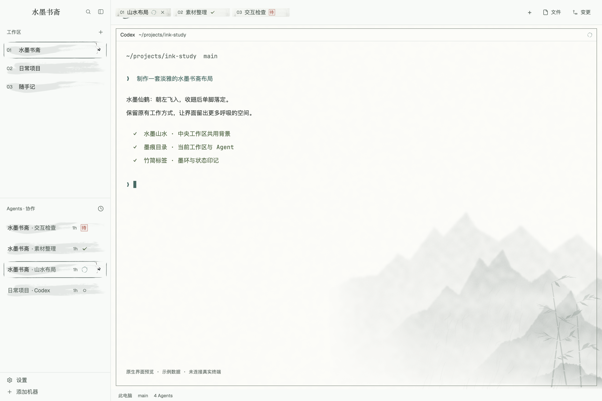

当前候选版为 **v18**：移除两行常驻信息、补齐水墨 footer 图标与左上淡竹。原 `ink-study-v17` 稳定标签保留。完整安装、已有会话重载与跨版本恢复见 `/Users/jiezhou/herdr-ink-study/V18-REVIEW.md`。

# 水墨书斋 · Ink Study

Herdr 0.1.13 的独立个人布局。当前版采用更明亮的近白纸色、用户参考图中的实际笔触、带竹纹和束绳的单片竹简标签，以及旋转墨圈。



## 本版调整

- 底色从 `#F5F3ED` 提亮至 `#FCFCF9`，侧栏从 `#F0EFE8` 提亮至 `#F8FAF8`，减少整体黄灰感；山水也同步调亮。
- 每个 Space / Agent 主行均有墨痕。底纹始终保持 `0.10` 的淡墨透明度，不因选中或悬停加深。普通状态无墨框，悬停显示淡墨框（0.28），选中显示清晰墨框（0.66），退出悬停后边框恢复。
- 墨痕采用参考图里的两种实际笔触，去除浅底，保留转折、毛边、飞白与散锋。适配横向行宽后按列表序号交替使用，不是随机，也不随交互切换；排序变化时，同一项可能使用另一笔迹。
- 顶部每个标签均为单片竹简：实拍竹纹、真实束绳、轻微切边。标签左右内边距从18px缩至12px，内部间距从9px缩至6px，关闭区域从22px缩至18px；最长名称限制为128px，悬停可看完整名称。竹材改为接近灰白的低饱和颜色，减少黄感。
- 工作环使用参考图中的不规则墨圈 PNG，整张图由 GPUI 原生 `spin(1600)` 连续旋转，一圈 1.6 秒。不是逐个四分之一圆切换高亮。
- 默认按优先级显示 Agent，但去掉「待确认 1」「已完成 1」「进行中 1」「空闲 1」这些分组标题；每行只显示状态符号，悬停有文字说明。按工作区分组仍可从菜单选择。
- 待确认使用朱砂「待」字小印，已完成使用墨勾，空闲使用空心圈。终端面板标题也使用同一套状态符号。

## 文件

- 正式布局：`/Users/jiezhou/herdr-ink-study/layouts/ink-study.json`
- 主题：`/Users/jiezhou/herdr-ink-study/themes/ink-study.json`
- 原生截图：`/Users/jiezhou/herdr-ink-study/preview-v7.png`
- 状态笔触动图：`/Users/jiezhou/herdr-ink-study/ink-ring-preview.gif`
- 检查报告：`/Users/jiezhou/herdr-ink-study/verification.txt`
- 独立布局包：`/Users/jiezhou/herdr-ink-study/ink-study.zip`

## 素材与权限

墨痕和墨圈来自用户提供的参考图，竹材来自公共领域摄影，详见 `/Users/jiezhou/herdr-ink-study/ART-NOTICE.md`。山水与纸纹由本项目脚本生成；没有复制 Traveler 的美术。

五个模块分别基于 Herdr 0.1.13 的 spaces、agents、tabs、pane、workspace-chrome 独立修改。保留工作区选择、Git 状态、拖动排序、Agent 聚焦与子 Agent、标签改名与关闭、分屏控制等操作。

ink-spaces 沿用原模块的 Git 与 hc 查询，读取工作区仓库状态；远端仓库通过 Herdr 已有连接查询。没有额外外部网络请求，没有读取对话、凭据或账号额度。

## 检查与范围

- 五个正式模块通过 Node 语法检查和 `herdr-app check`。
- 13 组原生示例数据检查覆盖空列表、窄侧栏、子 Agent、菜单、页脚与面板操作分支。
- 单独执行真实 render/event 代码，检查 Space 和 Agent 底纹恒定、鼠标进入出现墨框、鼠标离开隐藏墨框、选中显示墨框四种分支，以及标签悬停和关闭操作；宿主与数据使用测试替身。
- 独立 Herdr 窗口检查原生外观及无报错。预览中央使用原生文字模块与虚构内容，正式布局中央使用真实 active tab。
- 没有安装到 `/Users/jiezhou/.config/herdr-app`，没有更改原有窗口、个人设置或快捷键。真实终端合成及实际鼠标拖动、键盘交互留到安装后验收。

## 重新生成

需要 Herdr、Node.js、Python 3、Pillow、numpy。脚本从本机 Herdr 0.1.13 模块构建，只写本项目和临时检查目录。

```sh
python3 /Users/jiezhou/herdr-ink-study/scripts/make_art.py
python3 /Users/jiezhou/herdr-ink-study/scripts/refine_art.py
python3 /Users/jiezhou/herdr-ink-study/scripts/reference_art.py
python3 /Users/jiezhou/herdr-ink-study/scripts/make_crane.py
python3 /Users/jiezhou/herdr-ink-study/scripts/build_layout.py
python3 /Users/jiezhou/herdr-ink-study/scripts/prepare_review.py
python3 /Users/jiezhou/herdr-ink-study/scripts/verify.py
```

脚本不是安装程序。后续安装只复制正式 layouts、themes 和五个 ink-* 模块，先检查同名目标，禁止覆盖。`.review-home` 是虚构数据的验图环境，不应安装。

## 水墨仙鹤动作（已实现）

- 素材改用本次用户提供的水墨画参考，保留实际笔墨、羽毛、浓淡与毛边；只播放01–06，不收翅、不落地。
- 整段朝左，与从右方移入一致。仅原分解图01–06六个关键姿态，每两个姿态间隔400ms，平滑插值约25fps，整段2000ms后切换至第06帧静态飞行PNG。
- 位移由原生left/top过渡1600ms、opacity淡入400ms完成；GIF原生播放羽翼帧，JS只设一个2000ms的终态切换期限，不逐帧重绘。
- 每次重新选中建立新的播放节点ID。快速切换会取消旧期限，旧回调还带代次校验；已收起、关闭或切换的实例不会影响新动作。
- 初次显示时已有选中项直接静止；悬停、工作状态更新和重复布局不会重播动作。
- 小鹤在36×34px的裁切区内，显示34×33px；Space/Agent内容右侧分别留44/46px。底纹继续保持0.10淡墨，不遮挡名字或状态。
- `/Users/jiezhou/herdr-ink-study/crane-arrival-preview-v8.gif`：同素材的放大动作预览。
- `/Users/jiezhou/herdr-ink-study/crane-poses-v8.png`：01–06六个关键姿态及时间点。
- `/Users/jiezhou/herdr-ink-study/crane-native-preview.gif`：旧版v7独立Herdr窗口实际录制，虚构数据；27次截图包含10个不同的角落画面，连续原生动效已复核。
- 五个模块、13组原生分支、有限播放和快速切换检查通过；终态图在三条腿部扫描线上都只有一个支撑腿墨迹连通段。

可选原生复录：在生成review与验证之后运行 `/Users/jiezhou/herdr-ink-study/scripts/enable_motion_review.py`，以该review home打开独立Herdr窗口，运行 `/Users/jiezhou/herdr-ink-study/scripts/capture_crane.py`。控制器只改变虚构的预览选中项。重新执行prepare_review会恢复普通测试环境。


当前界面修订 v9：竹简容器40px，宽112–192px，并按宽度匹配材质图比例；空闲使用「闲」字水墨小印。应用侧栏、标题与状态栏的分隔线取自原墨迹扫描，按宽高自适应绘制，去掉终端pane的几何实线外框。进行中的水墨环改为保留原笔触的SVG，原生spin(1600)连续旋转；PNG不适用该旋转接口。真实窗口12帧均有不同旋转角度，见ring-native-proof-v9.gif。

布局现含六个个人模块，增加ink-status以保留原状态栏功能并修改其分隔线；Herdr自带模块未修改。终端程序内部的表格、输入框和横线仍由程序自己绘制。静态preview-v7.png为早期示例总览，以当前安装界面为准。后续定制直接维护mods和layouts；build_layout.py为早期生成器，不用于覆盖当前模块。

当前标签排版 v10：取消前置两位序号，标题使用14px宋体并弹性占位；状态和关闭按钮作为独立右侧操作区，状态固定16px、关闭固定18px，隐藏关闭时仍留位。竹简形状与40px高度沿用v9。


当前水墨序号使用 1–15 阿拉伯数字 PNG。标签恢复序号，状态和关闭仍靠右。结构线加深、山水底图再淡 30%。

Pi 会话样式来自本机 pretty-tui 扩展，配置 `inkStyle: true`：浅色用户气泡为 #f1f3ee、输入框为透明墨迹边框；暗色配色保持原样。正在运行的 Pi 需空闲时执行 `/reload` 加载扩展；Herdr 界面已经热更新。此布局 ZIP 不包含或自动安装 Pi 扩展。


字体与名称：左上角为「何德」，界面宋体 Songti SC，对话/终端使用 LXGW WenKai Mono（霞鹜文楷等宽）14px。字体仅在 ink-study 布局设置，未修改全局字体或其他布局。等宽文楷随布局分发，许可证见 mods/ink-chrome/fonts/OFL.txt；实机已核对中英文、数字和代码列对齐。


当前 v13：界面及竹简标题统一为 LXGW WenKai Mono；终端采用新命名的 Hede Ink Mono，在原文楷字形不变的前提下字宽加 1.6%，14px 中文额外约 0.224px、拉丁约 0.112px。左上角何德使用透明底行草 PNG（Zhi Mang Xing 字形，附少量干笔纹理）。均随布局热更新，无需 Pi /reload。

水墨样式的浅色用户消息气泡现在带浓墨纹理轮廓，保留宣纸内底和透明圆角。新会话直接生效，运行中的 Pi 空闲时 `/reload` 加载扩展代码。


当前侧栏 v15：工作区序号替换为固定 24px 的原创古风小物件（墨棋、毛笔、书卷、砚台、折扇、茶盏等共15种）。工作区和所属 Agent 使用同一图案，以工作区 ID 保存在共享状态中，改名或拖动排序不改变图案；超过15个同时存在的工作区会复用图案。折叠侧栏使用20px版本。

Agent 主卡片为「小物件 + 会话名 + 状态」，不再显示工作区文字前缀、Agent 程序名或状态持续时间。真实 pi.session_name 优先，其次手动标签名、去除 π / 程序前缀后的终端标题；会话名弹性占位，悬停可看完整标题，物件悬停显示工作区名称。没有命名的会话沿用清理后的终端标题，不生成新名称。子Agent展开、固定、聚焦、状态墨环与仙鹤保留。后续无需运行早期 build_layout.py 覆盖模块。

已热更新到当前 ink-study 窗口，无需 Pi /reload。当前截图：/Users/jiezhou/herdr-ink-study/sidebar-after-v15.png；小物件总览：/Users/jiezhou/herdr-ink-study/space-objects-v15.png。原生模块检查、13组数据分支以及稳定图案/标题来源/窄侧栏渲染检查通过。


当前小物件 v16（替代 v15 外观）：15 个物件全部重新绘制为单色毛笔水墨小品。以变化的笔压、浓淡积墨、散锋、飞白与淡墨铺色表现轮廓；透明底，无材质渐变、立体高光或物体投影。生成器为 scripts/make_space_objects.py，使用 Pillow 与 numpy。新版素材为 mods/ink-chrome/art/object-v16-*.png，原有工作区分配、24px占位与会话排版保持。

已热更新并检查当前原生侧栏，窗口错误为空。实际截图：/Users/jiezhou/herdr-ink-study/sidebar-detail-v16.png；15种物件总览（附24px小样）：/Users/jiezhou/herdr-ink-study/space-objects-v16.png。


Current selection style v17 (supersedes alternating row backgrounds): expanded Space and Agent rows use stroke-alt-v3.png by default; only the selected row uses stroke-v3.png. Hover keeps the default shape and reveals the existing ink frame. Changing selection restores the old row to the default shape and retains the crane arrival animation, finite playback and cancellation behavior.

Ink opacity is slightly deeper: 0.065 -> 0.085, identical across selected, unselected and hovered states. Bamboo-v17 textures add a 3% muted ink tint (about five RGB levels darker), retaining grain, bindings, alpha, dimensions and active/hover opacity. Regenerate with scripts/deepen_bamboo.py from the original bamboo-v9 textures.

Native screenshot: /Users/jiezhou/herdr-ink-study/selection-after-v17.png. Native checks, 13 fixture branches and render-event checks passed, including selection shape changes, restoring previous rows, hover stability and crane rapid-switch cancellation. Installed live; no Pi reload required.
