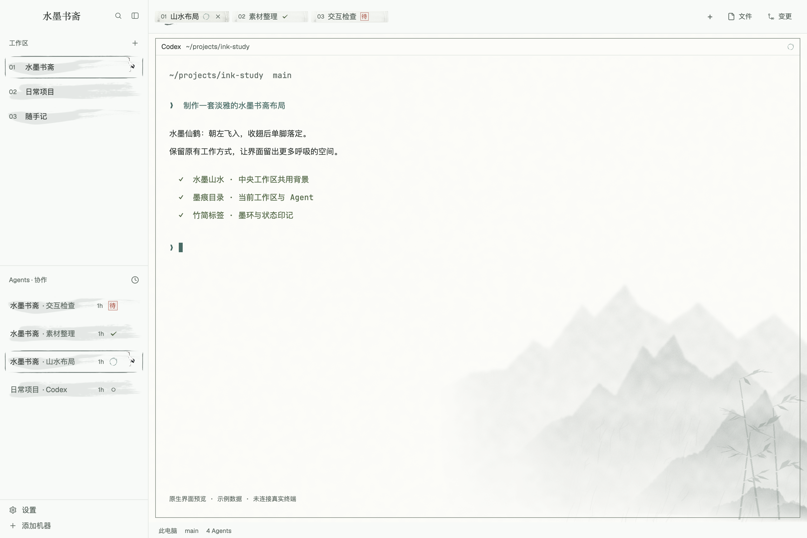

# 水墨书斋

明亮的近白工作界面，左侧每行有实际书写的墨痕，顶部是竹纹与束绳构成的单片竹简。山水与疏竹落在右下，左上留白。

## What you see

- 侧栏宽264px，底色 `#F8FAF8`；标题56px、Space行44px、Agent行44px。
- 纸色 `#FCFCF9`，主文字 `#303632`。底色减少黄灰感，状态色只占很小面积。
- 每个 Space / Agent 主行背后都有墨迹。实际笔触取自用户参考，保留按压、转折、飞白、毛边；两种笔迹按列表序号交替，与鼠标交互无关。
- 顶部60px，竹简标签40px，包含竹材纤维、真实束绳、两位序号、名称与状态符号。当前标签更清晰，并有细墨线。
- 中央右下是淡墨山水与竹叶，整个工作区共用，分屏不重复铺图。pane背景透明，间距8px、方角细边；标题30px。
- 默认 Agent 列表没有状态分组标题及计数。只在各行尾端保留状态符号与持续时间。

当前Space与Agent的右上角增加一只水墨仙鹤，选中变化时朝左缓慢飞入并扇翅，只保留原动作01–06，末尾停留在飞行姿态；名字区域继续保持淡墨。

## How it behaves

- 主行底纹透明度始终0.10；选中只显示细墨边框（0.66），悬停显示淡边框（0.28），普通状态无框。文字区域不随状态加深。
- working：实际墨圈图像原生连续旋转，一圈1600ms；blocked：朱砂「待」印；done：墨勾；idle：空心圈。符号悬停可查看文字说明。
- 优先级排序仍然生效，省略「待确认1」等分组头；可切换按工作区分组。
- 工作区点击、右键、拖动、Git提示及机器分组沿用原版。Agent聚焦、固定、子Agent沿用原版。
- 标签点击切换、双击改名、拖动排序、滚轮切换；关闭按钮在悬停或选中时显示，占位固定。
- 文件、变更、新建、分屏、窗口控制及原有快捷键保留。

仙鹤由参考水墨画分层提取：原生GIF在六个关键姿态间平滑插值，2000ms后切第06帧静态飞行图。位移1600ms、淡入400ms；第一布局事件启动唯一阶段期限，取消及代次校验处理快速切换。右侧预留44/46px。

## Built from

- 正式布局：`layouts/ink-study.json`；主题：`themes/ink-study.json`。
- 六个模块 ink-spaces、ink-agents、ink-tabs、ink-pane、ink-chrome、ink-status，复制修改自本机Herdr 0.1.13。
- 墨迹与墨圈从用户参考图提取透明通道；竹材纹理与束绳来自Titus Tscharntke公共领域摄影。来源见 `ART-NOTICE.md`。
- `image()` 把墨迹置于行底层，`on_hover` 更新悬停对象并通知重绘，底纹保持淡色，墨框图片opacity根据选中与悬停变化。
- 工作环为 `svg("mods/ink-chrome/art/ink-ring-v9.svg").spin(1600)`，无需四分之一圆逐段切换。
- 统一山水挂在work-body，root terminal_opacity为0.24。菜单、文件、变更和底部状态栏克隆为ink-status，保留功能并改用笔墨分隔线。
- ink-spaces保留原Git、hc查询，无新增外部网络读取，无对话或额度抓取。

## Watch out

- 原生image按固有比例容纳图片；行墨迹预先适配宽画布，避免短笔触被居中成一小团。
- 素材应使用带版本的文件名，避免图片缓存。
- 检查通过不等于真实终端的完整交互验收。预览使用虚构数据，正式布局才挂载active tab。
- 不要安装 `.review-home`，其中操作是测试替身。
- 字体不随包分发，标题宋体可由系统回退。模块针对Herdr 0.1.13，升级后需复核。

## Done when

- 六个模块与13组原生示例数据检查通过。
- 实际render/event代码验证底纹恒定淡色、悬停出现墨框、退出隐藏墨框、选中显示墨框，以及标签关闭的安全分支。
- 原生预览无错误，竹材、束绳、真实笔迹和状态图像可见。
- 后续安装后验收真实终端合成、鼠标拖动与键盘操作；已作为独立布局安装。

旧版v7曾完成连续原生录制。新版v8已更新到实际窗口且无错误；本次提供慢速素材预览，不将旧录制标作新动作。

当前v9：竹简按112–192px实际宽度生成40px高的匹配素材，避免contain比例挤扁。空闲卡片为「闲」字墨印，待确认为朱砂「待」字墨印。应用自己的分隔线取自参考墨迹的扫描覆盖，使用原生PathBuilder与百分比坐标适应宽高；颜色透明度写入paint背景以保证淡墨表现，移除pane直线外框，以聚焦标题墨线提示当前pane。终端内工具的线条由工具自己控制。

水墨环必须使用SVG调用spin。真实安装窗口连续截得12个不同旋转画面；不以脚本逐帧刷新。竹简拖动、关闭、面板切换、状态提示和仙鹤01–06慢动作保持原有行为。

当前标签排版 v10：取消前置两位序号，标题使用14px宋体并弹性占位；状态和关闭按钮作为独立右侧操作区，状态固定16px、关闭固定18px，隐藏关闭时仍留位。竹简形状与40px高度沿用v9。

字体与名称：左上角为「何德」，界面宋体 Songti SC，对话/终端使用 LXGW WenKai Mono（霞鹜文楷等宽）14px。字体仅在 ink-study 布局设置，未修改全局字体或其他布局。等宽文楷随布局分发，许可证见 mods/ink-chrome/fonts/OFL.txt；实机已核对中英文、数字和代码列对齐。

当前 v13：界面及竹简标题统一为 LXGW WenKai Mono；终端采用新命名的 Hede Ink Mono，在原文楷字形不变的前提下字宽加 1.6%，14px 中文额外约 0.224px、拉丁约 0.112px。左上角何德使用透明底行草 PNG（Zhi Mang Xing 字形，附少量干笔纹理）。均随布局热更新，无需 Pi /reload。

当前侧栏 v15：工作区序号替换为固定 24px 的原创古风小物件（墨棋、毛笔、书卷、砚台、折扇、茶盏等共15种）。工作区和所属 Agent 使用同一图案，以工作区 ID 保存在共享状态中，改名或拖动排序不改变图案；超过15个同时存在的工作区会复用图案。折叠侧栏使用20px版本。

Agent 主卡片为「小物件 + 会话名 + 状态」，不再显示工作区文字前缀、Agent 程序名或状态持续时间。真实 pi.session_name 优先，其次手动标签名、去除 π / 程序前缀后的终端标题；会话名弹性占位，悬停可看完整标题，物件悬停显示工作区名称。没有命名的会话沿用清理后的终端标题，不生成新名称。子Agent展开、固定、聚焦、状态墨环与仙鹤保留。后续无需运行早期 build_layout.py 覆盖模块。

已热更新到当前 ink-study 窗口，无需 Pi /reload。当前截图：preview.png；小物件总览：mods/ink-chrome/art/object-v16-inkstone.png。原生模块检查、13组数据分支以及稳定图案/标题来源/窄侧栏渲染检查通过。

当前小物件 v16（替代 v15 外观）：15 个物件全部重新绘制为单色毛笔水墨小品。以变化的笔压、浓淡积墨、散锋、飞白与淡墨铺色表现轮廓；透明底，无材质渐变、立体高光或物体投影。生成器为 scripts/make_space_objects.py，使用 Pillow 与 numpy。新版素材为 mods/ink-chrome/art/object-v16-*.png，原有工作区分配、24px占位与会话排版保持。

已热更新并检查当前原生侧栏，窗口错误为空。实际截图：sidebar-detail-v16.png；15种物件总览（附24px小样）：space-objects-v16.png。

Current selection style v17 (supersedes alternating row backgrounds): expanded Space and Agent rows use stroke-alt-v3.png by default; only the selected row uses stroke-v3.png. Hover keeps the default shape and reveals the existing ink frame. Changing selection restores the old row to the default shape and retains the crane arrival animation, finite playback and cancellation behavior.

Ink opacity is slightly deeper: 0.065 -> 0.085, identical across selected, unselected and hovered states. Bamboo-v17 textures add a 3% muted ink tint (about five RGB levels darker), retaining grain, bindings, alpha, dimensions and active/hover opacity. Regenerate with scripts/deepen_bamboo.py from the original bamboo-v9 textures.

Native screenshot: preview.png. Native checks, 13 fixture branches and render-event checks passed, including selection shape changes, restoring previous rows, hover stability and crane rapid-switch cancellation. Installed live; no Pi reload required.

当前标签以深墨竹叶替代序号；未选中标签继续显示原来的水墨序号。图标与数字同占20×18px，不改变标题和右侧按钮的位置；切换后原标签恢复数字。

当前选中标签使用F鹤羽（真实FLUX.1-schnell原画转换的灰阶路径SVG），替换之前竹叶。未选中标签仍显示数字序号，20×18占位及切换行为保持不变。

当前选中标签鹤羽已换为用户配置 codex/gpt-image-2 生成的透明PNG，保留原墨色和透明度，仅缩小素材以用于界面；20×18占位及其他标签数字序号不变。
